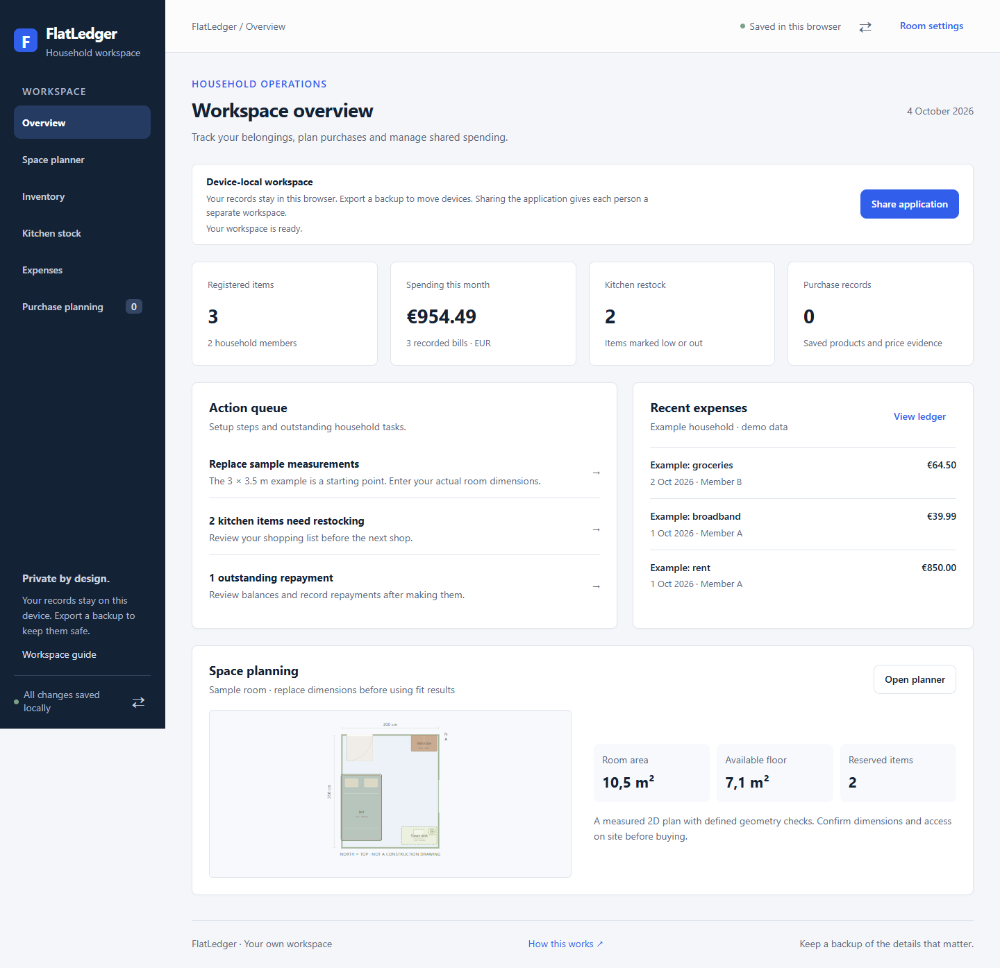

# FlatLedger

**A private workspace for household inventory, space planning and shared spending.**

I started with a practical question: would a new desk fit in my room before I bought it? I also needed a way to remember where things were kept and keep shared bills clear. FlatLedger brings those tasks into one workspace. The focus is useful records and checks that I can explain and test.

**[Open the application](https://roomies-satyam.satyamtomar524.chatgpt.site/)** · [Project guide](docs/PROJECT_GUIDE.md) · [Architecture](docs/ARCHITECTURE.md) · [Verification](docs/VERIFICATION.md)



## Core workflows

| Area | Purpose |
|---|---|
| Overview | See this month's spending, inventory counts, restock tasks, recent bills and a room preview |
| Space planner | Arrange measured furniture; check boundaries, overlaps and defined clearances; reserve future space |
| Inventory | Record an item's owner, quantity, room and exact storage location; search and filter records |
| Kitchen stock | Maintain fridge, freezer and pantry entries; turn low/out entries into a shopping checklist |
| Expenses | Split bills in integer cents, record repayments, review monthly bill templates, filter spending by period/category and export reports |
| Purchase planning | Link exact product dimensions to a reservation and keep dated price, delivery and variant evidence |

The application starts with a labelled **3 × 3.5 m sample room** and an empty household ledger. Replace the sample dimensions before relying on a fit result. No possessions or financial records are invented.

## What is feasible today

This release is a **single-workspace household tool**. A person can maintain the household records and use exports to discuss costs with flatmates. The public website saves each visitor's SQLite database in their own browser through IndexedDB. Sharing the application link gives a friend a separate workspace. Export a backup to move between devices; clearing site data removes stored records.

The expense report filters **recorded bills**, using their bill date. Repayments change outstanding balances without increasing spending. Reports use the selected period/category/search; balances always use the complete ledger. All amounts are EUR; there is no currency conversion or bank connection.

The room planner uses rectangular footprints and explicit clearance rules. It supports rough planning, not construction drawings or 3D rendering. Purchase checks are deterministic rules, not an AI model. The browser edition uses manual price observations. The local server can check a narrow class of permitted public JSON-LD product pages; no real retailer has yet been demonstrated as compatible. There is no always-on shopping crawler.

Live household accounts and synchronization are future work. They would require authentication, permissions, conflict handling and a hosted database. See the [scope and feasibility record](docs/PRODUCT_SCOPE.md).

## Run locally

Python 3.10 or later; the application has no third-party Python runtime dependencies.

```sh
git clone https://github.com/satyamtomar524-tech/flatledger.git
cd flatledger
python -m roommate --no-tracker
```

Open `http://127.0.0.1:8765`. Installing with `pip install .` also exposes the `flatledger` command. The original `roommate` module and `roomies` command remain compatible. The existing public URL and browser storage namespace are retained through the rename to preserve records.

## Implementation and checks

Python validates records, calculates geometry and expense splits, and persists SQLite transactions. Plain JavaScript and SVG handle the interface. The static version runs the same Python rules in a Pyodide worker and serves its runtime files from the same origin. No external AI service or API key is required.

```sh
python -B -m unittest discover -s tests -q
node --test tests/reports.test.cjs
npm install --ignore-scripts
npm run check
npm run test:browser
npm run test:regressions
python scripts/build_browser.py
npm run test:public
```

Browser checks use disposable databases. [Verification instructions](docs/VERIFICATION.md) include installed-browser settings and the static regression command. [GitHub Actions](https://github.com/satyamtomar524-tech/flatledger/actions) runs the checks on updates.

The project was developed with coding assistance. [Portfolio notes](docs/PORTFOLIO.md) describe the implementation and an interview demonstration. Actual use, savings and productivity improvements have not been measured.

## References and license

[Room-Planner](https://github.com/EricAndrechek/Room-Planner) and [price-tracker](https://github.com/sonoyumi/price-tracker) were feature references for the initial idea. Their source was not copied.

MIT license · Satyam Tomar
